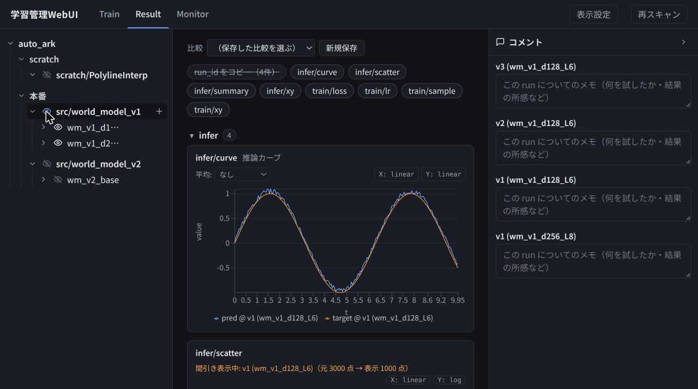
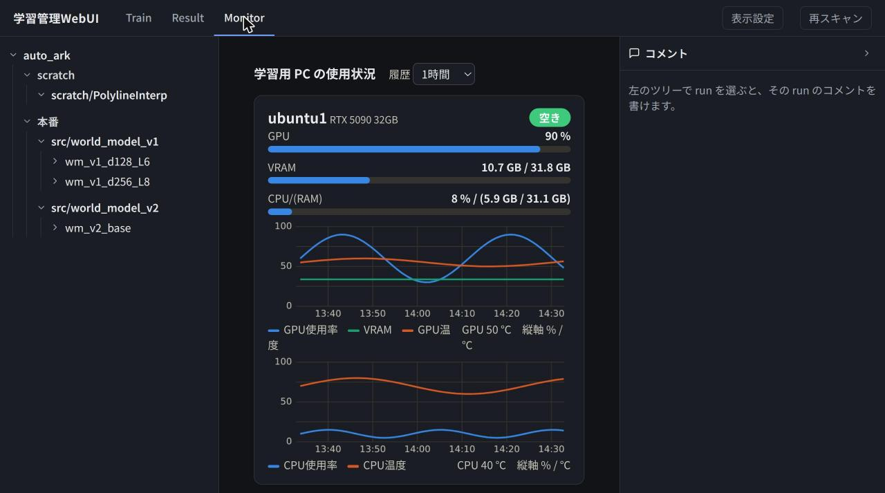

# train-webui

複数台の GPU マシンで機械学習の学習・推論を起動・監視・比較するための、自作の学習管理 WebUI です。
個人の研究プロジェクト（ゲームの自動攻略の研究。拡散モデルで攻略の計画を出す）で、実験管理を wandb から乗り換えるために作り、2026 年 9 月から毎日の学習で使っています。



## 何を解決したか

- **GPU マシンが複数台あり、ほかの人と共有している**: 学習を始めるたびに、各台の GPU を測り直します。ほかの人が使っている台や、全体で残しておく空き台を守りながら、優先度の高い台を自動で選びます（`backend/scheduler.py`）。
- **実験の記録が散らばる**: run ごとに config・コードの snapshot・重み・ログを紐づけて保存します。グラフの比較、画像、コメントを 1 画面で見られます。
- **AI（Claude）と結果を相談しながら実験を回したい**: 読み取り専用の CLI（`cli.py`）と、config の編集・起動・停止をする CLI（`ctl.py`）を用意しています。AI のエージェントが画面を使わずに結果を読み、次の実験を起動できます。

## 主な機能

| 機能 | 内容 |
|---|---|
| プロジェクトの自動検出 | repo の中から `main.py` + `config.toml` 形式の学習プロジェクトを探し、ツリーで表示 |
| 学習・推論の起動 | config の下書き → 起動 → 停止。学習用マシンへ ssh/rsync でコードを送り、コンテナの中で実行 |
| 台の自動選択 | 優先度・ほかの人の使用・全体の空き台の数・同時に動かすジョブの数から、使う台を決める。使えない時は台ごとの理由を返す |
| 結果の記録 | wandb に近い書き味の Python client（標準ライブラリのみ）で、数値・画像・軸つきのグラフを送る |
| 比較 | run をまたいだグラフの重ね合わせ、点の多い系列の間引き、比較の保存 |
| モニタ | 各台の GPU・VRAM・CPU の使用状況と履歴 |
| 通知 | 台が空いているのにエージェントが止まっている時に、画面のバナーと webhook で知らせる |
| PWA | スマホからアプリとして開ける |



## 構成

```
[手元の PC]                                 [学習用 GPU マシン（複数台）の コンテナ]
 backend (FastAPI + sqlite)  --ssh/rsync-->   コードの同期先・run.log
   ├ プロジェクトの検出                          main.py（学習・推論）
   ├ run / config / ジョブの管理                   └ client で結果を送る
   ├ 台の測定と自動選択   <------http---------     (数値・画像・グラフ)
   └ 結果の受信
 frontend (React + Vite + Recharts)
   └ Train / Result / Monitor タブ
 cli.py / ctl.py（AI エージェント用の CLI）
```

- backend: Python 3.10 / FastAPI / sqlite。ssh と rsync は `~/.ssh/config` をそのまま使えるように、コマンドを subprocess で呼びます。ControlMaster で台ごとに 1 本の接続を使い回します
- frontend: React 18 / TypeScript / Vite / Recharts
- client: Python の標準ライブラリのみ。学習用マシンに追加のパッケージは要りません
- テスト: pytest 251 件（scheduler、複数台の動き、アクセス制限、client の API、run の系譜 など）

設計の詳細は [`train_webui/design.md`](train_webui/design.md)、各部の境界（HTTP API・DB・client）は [`train_webui/CONTRACT.md`](train_webui/CONTRACT.md) にあります。

## 使い方

```bash
python -m venv venv && venv/bin/pip install -r train_webui/requirements.txt
cp train_webui/server.example.toml train_webui/server.toml   # 学習用マシンの接続先を書く
(cd train_webui/frontend && npm ci && npm run build)
venv/bin/python -m train_webui.backend                        # http://localhost:8000
```

画面だけを試すなら、モックのデータで frontend を起動できます。

```bash
cd train_webui/frontend && npm ci && npm run dev:mock          # http://localhost:5174
```

学習コードの側では、次のように結果を送ります。

```python
from train_webui import client

client.init(new_run=True)
for step in range(n_steps):
    client.log({"train/loss": loss}, step=step)
client.log_image("infer/sample", fig)
client.finish()
```

テストの実行:

```bash
venv/bin/python -m pytest train_webui
```

## 開発の進め方

AI（Claude）を使って開発しました。役割は次のように分けています。

- **自分**: 要件と設計を決めました（`design.md`）。実装を並列で進めるために、担当ごとの境界（API・DB・client の契約）を `CONTRACT.md` に定めました。動作の検証と、毎日の運用、そこで見つかった問題からの改善（複数台への対応、空き台のルール、通知 など）も自分でやっています
- **AI**: 契約に沿った各部の実装とテストの作成。commit の `Co-Authored-By` に記録しています

## License

MIT
